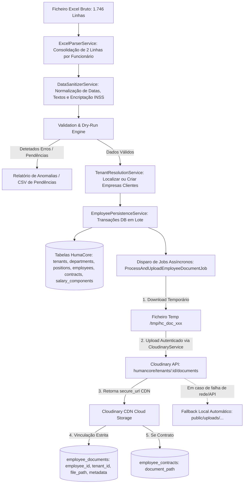

# PLANO DE IMPLEMENTAÇÃO: IMPORTAÇÃO E MIGRAÇÃO DE DADOS DE RH VIA EXCEL

> **Documento:** Plano de Arquitetura e Execução da Funcionalidade de Importação Excel  
> **Sistema:** HumaCore (HRMS Multi-Tenant para Angola)  
> **Ficheiro Fonte Analisado:** `Datos_de_RH员工数据库_20261029210852只保存15天.xlsx`  
> **Data:** 30 de Outubro de 2026  
> **Estado:** Proposta Técnica Detalhada para Execução Imediata  

---

## 1. Visão Geral e Objetivos

O sistema **HumaCore** necessita de uma funcionalidade robusta de importação de dados de Recursos Humanos via Excel, tendo como prioridade imediata o **carregamento integral e sem perdas dos 933 trabalhadores** distribuídos por **54 empresas/clientes**, atualmente registados na folha de cálculo exportada do sistema de formulários Jiandaoyun.

### Objetivos Principais
1. **Migração Integral dos Dados Existentes:** Ingerir com 100% de integridade todos os dados dos 933 colaboradores (dados pessoais, laborais, contratuais, salariais e links de documentos anexos) para o esquema relacional multi-tenant do HumaCore.
2. **Resolução de Complexidade Estrutural (Parent-Child):** Processar a estrutura do ficheiro onde cada trabalhador ocupa **2 linhas** (Linha principal com dados do funcionário/empresa e Linha secundária com sub-registo de modelo contratual/credenciais).
3. **Módulo Reutilizável de Importação no HumaCore:** Criar uma funcionalidade nativa e permanente no sistema (Backend Laravel + Frontend React), permitindo que administradores importem novos funcionários através de folhas de cálculo padronizadas com validação prévia (*dry-run*), correspondência de colunas e tratamento de erros linha a linha.
4. **Resgate de Documentos e Envio ao Cloudinary Vinculado a Cada Funcionário:** Realizar o *download* seguro de todos os ficheiros de suporte (BI frente/verso, comprovativos de NIF, minutas Word, PDFs de contratos assinados, carta de condução, registo criminal, atestados de residência e certificados) referenciados por URLs temporários da Jiandaoyun (`files.jiandaoyun.com`) antes que os tokens expirem (aviso: *"只保存15天"* — retenção de 15 dias). Cada documento é enviado para o **Cloudinary** através do serviço nativo do sistema [`CloudinaryService`](file:///home/computer-development/code/humancore/backend/app/Services/CloudinaryService.php) e vinculado de forma estrita e unívoca ao respetivo colaborador na tabela [`employee_documents`](file:///home/computer-development/code/humancore/backend/app/Models/EmployeeDocument.php) (e [`employee_contracts.document_path`](file:///home/computer-development/code/humancore/backend/app/Models/EmployeeContract.php)), salvaguardando a URL CDN definitiva, tipo, tamanho e nome original.
5. **Segurança e Higienização de Credenciais:** Tratar de forma segura palavras-passe e utilizadores do INSS que se encontram em texto simples na folha original, encriptando-os nas credenciais dos clientes/tenants em vez de os expor nos perfis de utilizador.

---

## 2. Anatomia Detalhada da Folha de Cálculo e Desafios Identificados

A folha `Datos de RH员工数据库` possui **1.746 linhas** e **107 colunas** bilíngues (Português / Chinês).

```
Estrutura da Planilha:
┌────────────────────────────────────────────────────────────────────────────────────────┐
│ Linha 1: Cabeçalhos Principais de Blocos (ex.: Informa.Servi. RH, Column1..Column11)   │
├────────────────────────────────────────────────────────────────────────────────────────┤
│ Linha 2: Sub-Cabeçalhos das Sub-Tabelas (ex.: Sede, Tipo de Contrato, OBS, etc.)       │
├────────────────────────────────────────────────────────────────────────────────────────┤
│ Linha 3: [data_id=6ae21d...] Funcionário 1 (ALFREDO BENJAMIM DOMINGOS) + Sub-registo 1 │
│ Linha 4: [data_id=         ] Funcionário 1 continuação (Sub-registo 2: Modelo Indeterm.)│
├────────────────────────────────────────────────────────────────────────────────────────┤
│ Linha 5: [data_id=6ae21c...] Funcionário 2 (DANIEL EDUARDO) + Sub-registo 1            │
│ Linha 6: [data_id=         ] Funcionário 2 continuação (Sub-registo 2)                 │
└────────────────────────────────────────────────────────────────────────────────────────┘
```

### 2.1 Estatísticas Críticas dos Dados
- **933 Trabalhadores únicos:** Identificados univocamente pelo `data_id` (Coluna A) e pelo `Numero deTrabalhotor` (Coluna AC, formato `S.RH202600xxxx`).
- **54 Empresas Clientes:** Identificadas na coluna `Nome de Empressa` (F) e `nome de cliente` (E).
  - *Atenção:* 216 registos estão com empresa em branco e 188 sem cliente explícito.
- **Datas em Formato Serial Excel:** As datas estão em numeração serial flutuante (ex.: `46323.33` = `28/10/2026`, `45919.29` = `19/09/2025`). É obrigatória a conversão pela fórmula base `1899-12-30 + dias`.
- **Anomalias de BI e NIF:**
  - 69 registos sem BI.
  - BI `008099401HA040` surge repetido em 20 registos (casos de funcionários com vários contratos ou registo provisório).
  - 47 BIs assinalados como caducados ("Ja caduco").
  - 240 registos com NIF inativo ("NAO") e 484 pendentes de consulta.
- **Salários (713 registos com valores):**
  - Salário Base: Mediana de 100.000 Kz (máximo 440.000 Kz).
  - Subsídios de transporte e alimentação raramente preenchidos (maioria com 0).
  - Salário líquido máximo de 600.000 Kz.

---

## 3. Matriz Completa de Mapeamento (Excel → Base de Dados HumaCore)

Abaixo define-se a correspondência exata entre as colunas do Excel original e as tabelas/campos da base de dados do HumaCore:

### 3.1 Empresas e Clientes (`tenants`)
| Coluna Excel | Campo Destino no HumaCore | Tipo | Regra de Transformação / Higienização |
|---|---|---|---|
| Col F (`Nome de Empressa`) | `tenants.name` | `string` | Se vazio, usar Col E (`nome de cliente`). Se ambos vazios, atribuir a `Empresa Pendente / A Classificar`. |
| Col E (`nome de cliente`) | `tenants.config->client_name` | `string` | Armazenado no JSON de configuração do tenant. |
| Col G (`NIF税号`) | `tenants.tax_id` | `string` | NIF da empresa (10 dígitos). Normalizar e limpar espaços. |
| Col H (`Tipo de emprssa`) | `tenants.legal_entity_type` | `string` | Mapear: "Lda" -> `lda`, "S.A." -> `sa`, "Unipessoal" -> `unipessoal`. |
| Col V (`Sede总部地点`) | `tenants.address` | `text` | Morada corporativa da sede em Luanda/Angola. |
| Col O (`Número deINESS de empre`) | `tenants.inss_number` | `string` | Número de inscrição da empresa na Segurança Social. |
| Col P e Q (`Utilizatorsob / Senha INESS`) | `tenants.config->inss_credentials` | `encrypted` | **Segurança Máxima:** Encriptar com `Crypt::encryptString()`. Nunca expor em logs ou campos abertos. |

### 3.2 Departamentos e Cargos (`departments`, `positions`)
| Coluna Excel | Campo Destino | Tipo | Regra de Transformação |
|---|---|---|---|
| Col AJ (`Departamento所属部门`) | `departments.name` | `string` | Limpar sufixos chineses: `Vendas销售` -> `Vendas`, `D.RH` -> `Recursos Humanos`, `D.Dutros` -> `Geral / Outros`. Criado dentro de cada tenant. |
| Col AK (`Categoria职位`) | `positions.title` | `string` | Limpar sufixos chineses: `Vendedor销售员` -> `Vendedor`, `Operador` -> `Operador`, `Técnico` -> `Técnico`. Associar ao departamento correspondente. |

### 3.3 Funcionários (`employees`)
| Coluna Excel | Campo Destino | Tipo | Regra de Transformação |
|---|---|---|---|
| Col AC (`Numero deTrabalhotor`) | `employees.employee_code` | `string(50)` | Código original (ex.: `S.RH2026001207`). Chave única por tenant. |
| Col AD (`Nome姓名`) | `employees.first_name`, `employees.last_name` | `string` | Algoritmo de divisão: Primeira palavra -> `first_name`; Restantes palavras -> `last_name`. |
| Col AE (`Telefone 员工电话`) | `employees.phone` | `string` | Formatar para padrão angolano (`+244 9xx xxx xxx`). |
| Col AF (`Pessoa/contacto emergência`) | `employees.alternative_phone` | `string` | Extrair nome e telefone de contacto de emergência. |
| Col AG (`Endereço residencial atual`) | `employees.address` | `text` | Morada de residência do trabalhador. |
| Col AH (`País de cidadania国籍`) | `employees.nationality` | `string` | Normalizar: `ANGOLA` -> `Angolana`, `CHINA` -> `Chinesa`. |
| Col AI (`número de identificação`) | `employees.id_document_number` | `string` | Número do BI / Passaporte. Se ausente, preencher com `PROV-{employee_code}` e assinalar pendência. |
| Col AS / BB (`Bilhete -Valido ate`) | `employees.id_document_expiry` | `date` | Converter número serial Excel para data (`YYYY-MM-DD`). |
| Col BF / BI (`Atualmente Situação de trabalho`) | `employees.status` | `enum` | `No trabalho在职` -> `active`; `Já saíram/离职` -> `terminated`; `Período experimental` -> `active`. |
| Col BN / BH (`Atualmente data de entra`) | `employees.hired_at` | `date` | Converter serial Excel para data (`YYYY-MM-DD`). Data de admissão. |
| Col BJ / BQ (`Data de saída离职日期`) | `employees.termination_at` | `date` | Preenchido apenas para trabalhadores desligados. |
| Col BK / BR (`Método de demissão`) | `employees.termination_reason` | `text` | Concatenar método e motivo da saída (`Col BL / BS`). |
| Col AQ / AR (`Consuta NIF ja autolizar`) | `employees.tax_id` / metadata | `string` | Se ativo, usar NIF (ou BI se for cidadão nacional cujo BI = NIF). |
| Col BO (`estatuto deINESS社保状态`) | `employees.social_security_id` / metadata | `string` | Estado do INSS e número caso conste em Col AB (`INSS: xxxxxxx`). |

### 3.4 Contratos de Trabalho (`employee_contracts`)
| Coluna Excel | Campo Destino | Tipo | Regra de Transformação |
|---|---|---|---|
| Col CD / Y (`tipo de contrato合同类型`) | `employee_contracts.contract_type` | `enum` | `Determinado Por 3 meses` -> `fixed_term`; `Indeterminado` -> `permanent`; `Estágio` -> `internship`. |
| Col BU / CE (`Sal. básico基本工资`) | `employee_contracts.base_salary` | `decimal` | Valor numérico em Kz (ex.: 100000.00). |
| Col CF (`INÍCIO开始时间`) | `employee_contracts.start_date` | `date` | Data de início do contrato. Fallback para `hired_at`. |
| Col CG (`TERMINO结束时间`) | `employee_contracts.end_date` | `date` | Data de fim para contratos a termo determinado. |
| Col CL / X (`Estabelecimento实际合同地点`) | `employee_contracts.notes` | `text` | Guardar localização contratual efetiva e notas do modelo. |
| Status laboral do funcionário | `employee_contracts.is_active` | `boolean` | `true` se funcionário estiver em funções (`active`). |

### 3.5 Componentes Salariais (`employee_salary_components`)
| Coluna Excel | Componente no HumaCore | Tipo | Regra |
|---|---|---|---|
| Col BV (`Subsí. alimentacao`) | Subsídio de Alimentação | `custom_value` | Criar registo se valor > 0. |
| Col BW (`Subsí. transporte`) | Subsídio de Transporte | `custom_value` | Criar registo se valor > 0. |
| Col BX (`Horas extra`) | Horas Extraordinárias | `custom_value` | Criar registo histórico se valor > 0. |
| Col BY (`A.adicionadl`) | Outros Adicionais / Bónus | `custom_value` | Criar registo se valor > 0. |

### 3.6 Gestão de Documentos Físicos e Anexos (`employee_documents`)

Seguindo o padrão arquitetural do HumaCore (implementado em [`CloudinaryService`](file:///home/computer-development/code/humancore/backend/app/Services/CloudinaryService.php) e [`EmployeeDocumentController`](file:///home/computer-development/code/humancore/backend/app/Http/Controllers/Api/V1/Document/EmployeeDocumentController.php)), **nenhum documento será mantido como link efêmero da Jiandaoyun**. 

Todos os ficheiros serão baixados temporariamente pelo sistema e enviados diretamente para o **Cloudinary** através do fluxo oficial da aplicação, associando cada URL CDN segura ao respetivo funcionário (`employee_id`) e empresa (`tenant_id`):

| Coluna Excel | Tipo de Documento (`document_type`) | Destino no BD | Pasta no Cloudinary | Recurso Cloudinary | Ação de Migração e Vinculação |
|---|---|---|---|---|---|
| Col AN (`frente de Copia de B.I`) | `id_card_front` | `employee_documents` | `humancore/tenants/{tenant_id}/documents` | `image` / `auto` | Download temporário $\rightarrow$ Upload Cloudinary $\rightarrow$ Cria `EmployeeDocument` com `employee_id` do trabalhador e validade do BI. |
| Col AO (`verso de Copia de B.I`) | `id_card_back` | `employee_documents` | `humancore/tenants/{tenant_id}/documents` | `image` / `auto` | Download temporário $\rightarrow$ Upload Cloudinary $\rightarrow$ Cria `EmployeeDocument` vinculado ao `employee_id`. |
| Col AR (`Comprovativo de NIF`) | `tax_id` | `employee_documents` | `humancore/tenants/{tenant_id}/documents` | `image` / `auto` | Download temporário $\rightarrow$ Upload Cloudinary $\rightarrow$ Cria `EmployeeDocument` vinculado ao `employee_id`. |
| Col AU (`Registo criminal`) | `criminal_record` | `employee_documents` | `humancore/tenants/{tenant_id}/documents` | `image` / `auto` | Download temporário $\rightarrow$ Upload Cloudinary $\rightarrow$ Cria `EmployeeDocument` vinculado ao `employee_id`. |
| Col AV (`Cartao de conducao`) | `driving_license` | `employee_documents` | `humancore/tenants/{tenant_id}/documents` | `image` / `auto` | Download temporário $\rightarrow$ Upload Cloudinary $\rightarrow$ Cria `EmployeeDocument` vinculado ao `employee_id`. |
| Col AW (`Atestado de residencia`) | `residence_certificate` | `employee_documents` | `humancore/tenants/{tenant_id}/documents` | `image` / `auto` | Download temporário $\rightarrow$ Upload Cloudinary $\rightarrow$ Cria `EmployeeDocument` vinculado ao `employee_id`. |
| Col AX (`Certificado escola`) | `education_certificate` | `employee_documents` | `humancore/tenants/{tenant_id}/documents` | `image` / `auto` | Download temporário $\rightarrow$ Upload Cloudinary $\rightarrow$ Cria `EmployeeDocument` vinculado ao `employee_id`. |
| Col AY (`Certificados profissionais`) | `professional_cert` | `employee_documents` | `humancore/tenants/{tenant_id}/documents` | `image` / `auto` | Download temporário $\rightarrow$ Upload Cloudinary $\rightarrow$ Cria `EmployeeDocument` vinculado ao `employee_id`. |
| Col CM (`Carregar contrato WORD`) | `contract_doc` | `employee_documents` e `employee_contracts.document_path` | `humancore/tenants/{tenant_id}/contracts` | `raw` | Download temporário $\rightarrow$ Upload Cloudinary $\rightarrow$ Salva em `employee_documents` e atualiza `EmployeeContract` do colaborador. |
| Col CN (`Carregar contrato PDF`) | `contract_pdf` | `employee_documents` e `employee_contracts.document_path` | `humancore/tenants/{tenant_id}/contracts` | `raw` / `auto` | Download temporário $\rightarrow$ Upload Cloudinary $\rightarrow$ Salva em `employee_documents` e vincula como contrato ativo do colaborador. |
| Col CQ (`CERTIFICADO DE INEFOPE`) | `inefop_certificate` | `employee_documents` | `humancore/tenants/{tenant_id}/documents` | `auto` | Download temporário $\rightarrow$ Upload Cloudinary $\rightarrow$ Cria `EmployeeDocument` associado à homologação INEFOPE do trabalhador. |

---

## 4. Arquitetura da Solução Técnica

A solução divide-se em duas componentes integradas:
1. **Comando CLI de Migração Inicial (`php artisan humancore:import-legacy-rh`):** Para ingestão massiva e resiliente do ficheiro Jiandaoyun, processamento em lote e envio assíncrono dos documentos para o Cloudinary via filas do Horizon/Redis.
2. **Módulo Web Reutilizável de Importação Excel (Backend API + Frontend React):** Interface para administradores e gestores de RH importarem novos lotes no dia a dia.



---

## 5. Fases de Execução e Plano de Trabalho

### Fase 1: Limpeza, Preparação e Sanitização Prévia dos Dados
1. **Script de Pré-Validação e Higienização:**
   - Ler o ficheiro `Datos_de_RH员工数据库_20261029210852只保存15天.xlsx` através de um parser em PHP/Python que junta as duas linhas de cada registo com base no `data_id` / `Numero deTrabalhotor`.
   - Gerar uma versão canónica intermédia estruturada em JSON/SQLite temporário para auditoria.
2. **Mapeamento de Casos Especiais:**
   - **Empresas não preenchidas (216 casos):** Criar uma entidade corporativa provisória denominada *"Empresa Pendente (A Designar)"* com a indicação do cliente quando existente (ex.: `Gu Fang-1`).
   - **BIs Duplicados (ex.: 008099401HA040):** Diferenciar os registos permitindo a vinculação a contratos/empresas diferentes, registando uma entrada no log de auditoria com alerta de duplicidade para validação pelo departamento de RH.
   - **BIs em Falta (69 casos):** Atribuir provisoriamente o código `PENDENTE-{employee_code}` para evitar quebras em restrições de integridade, marcando o colaborador com a flag `pending_id_document = true`.

### Fase 2: Implementação do Núcleo de Processamento no Backend (Laravel)
1. **Instalação de Dependência de Alta Performance:**
   - Instalar `openspout/openspout` ou `phpoffice/phpspreadsheet` via composer para suporte nativo a leitura de ficheiros Excel em *streaming* com consumo mínimo de memória RAM.
2. **Serviços Especializados:**
   - `App\Services\Import\ExcelLegacyRhParser`: Responsável por percorrer as linhas, mesclar os sub-registos da Linha 2 com a Linha 1, e instanciar DTOs fortemente tipados (`LegacyEmployeeRowDTO`).
   - `App\Services\Import\DataSanitizerService`: Converte os números seriais de data Excel (`float` -> `YYYY-MM-DD`), normaliza nomes próprios em maiúsculas/minúsculas, higieniza números de telefone e extrai credenciais INSS para armazenamento seguro.
   - `App\Services\Import\TenantResolutionService`: Procura a empresa pelo NIF ou Nome. Caso não exista, instancia o `Tenant` com os dados padrão de Angola (Moeda AOA, Fuso Horário `Africa/Luanda`, Província Luanda).
   - `App\Services\Import\EmployeeImportPipeline`: Executa a persistência dentro de uma transação de base de dados (`DB::beginTransaction() / commit() / rollBack()`), garantindo criação coordenada de:
     - `Tenant` (se novo)
     - `Department` e `Position`
     - `Employee`
     - `EmployeeContract`
     - `EmployeeSalaryComponent`
     - Disparo do Job `ProcessAndUploadEmployeeDocumentJob` para cada anexo detetado.
3. **Queue Job para Descarregamento e Envio ao Cloudinary:**
   - `App\Jobs\ProcessAndUploadEmployeeDocumentJob`: Job assíncrono executado via Redis/Horizon que implementa o fluxo oficial de documentos do HumaCore:
     ```php
     namespace App\Jobs;

     use App\Models\Employee;
     use App\Models\EmployeeContract;
     use App\Models\EmployeeDocument;
     use App\Services\CloudinaryService;
     use Illuminate\Bus\Queueable;
     use Illuminate\Contracts\Queue\ShouldQueue;
     use Illuminate\Foundation\Bus\Dispatchable;
     use Illuminate\Queue\InteractsWithQueue;
     use Illuminate\Queue\SerializesModels;
     use Illuminate\Support\Facades\Http;
     use Illuminate\Support\Facades\Log;

     class ProcessAndUploadEmployeeDocumentJob implements ShouldQueue
     {
         use Dispatchable, InteractsWithQueue, Queueable, SerializesModels;

         public int $tries = 3;
         public int $timeout = 120;

         public function __construct(
             public int $employeeId,
             public int $tenantId,
             public string $documentType,
             public string $documentName,
             public string $sourceUrl,
             public ?int $contractId = null,
             public ?string $expiryDate = null,
             public ?int $uploaderId = null
         ) {}

         public function handle(CloudinaryService $cloudinary): void
         {
             // 1. Download do ficheiro a partir da URL temporária da Jiandaoyun
             $response = Http::timeout(45)->get($this->sourceUrl);
             if (! $response->successful()) {
                 Log::error("Falha ao descarregar documento para funcionário #{$this->employeeId}", [
                     'url' => $this->sourceUrl,
                     'status' => $response->status(),
                 ]);
                 return;
             }

             // Extrair extensão e gravar temporariamente
             $parsedUrl = parse_url($this->sourceUrl, PHP_URL_PATH);
             $extension = pathinfo($parsedUrl, PATHINFO_EXTENSION) ?: 'jpg';
             $tempFile = sys_get_temp_dir() . '/hc_doc_' . uniqid() . '.' . $extension;
             file_put_contents($tempFile, $response->body());

             try {
                 // 2. Definir pasta e tipo de recurso no Cloudinary
                 $isContract = in_array($this->documentType, ['contract_doc', 'contract_pdf']);
                 $folder = $isContract 
                     ? "humancore/tenants/{$this->tenantId}/contracts" 
                     : "humancore/tenants/{$this->tenantId}/documents";
                 $resourceType = ($extension === 'docx' || $extension === 'doc') ? 'raw' : 'auto';

                 // 3. Executar o upload via CloudinaryService nativo
                 $uploadResult = $cloudinary->upload($tempFile, $folder, $resourceType);
                 $cdnUrl = $uploadResult['url'];

                 // 4. Vincular estritamente ao funcionário específico na tabela employee_documents
                 EmployeeDocument::create([
                     'employee_id'     => $this->employeeId,
                     'tenant_id'       => $this->tenantId,
                     'uploader_id'     => $this->uploaderId,
                     'name'            => $this->documentName,
                     'document_type'   => $this->documentType,
                     'file_path'       => $cdnUrl,
                     'original_name'   => basename($parsedUrl) ?: "{$this->documentType}.{$extension}",
                     'mime_type'       => mime_content_type($tempFile) ?: 'application/octet-stream',
                     'file_size'       => $uploadResult['bytes'] ?? filesize($tempFile),
                     'expiry_date'     => $this->expiryDate,
                     'is_confidential' => false,
                 ]);

                 // 5. Se for contrato, vincular também em employee_contracts.document_path
                 if ($this->contractId && $isContract) {
                     EmployeeContract::where('id', $this->contractId)
                         ->update(['document_path' => $cdnUrl]);
                 }
             } finally {
                 // 6. Eliminar sempre o ficheiro temporário local
                 @unlink($tempFile);
             }
         }
     }
     ```
   - Inclui mecanismo de **3 tentativas (*retries*)** com tolerância a falhas: caso o serviço Cloudinary esteja temporariamente indisponível, o método `fallbackLocalUpload()` do `CloudinaryService` preserva o ficheiro localmente sem perda de dados.

### Fase 3: Comando CLI para Ingestão Inicial e Relatório de Validação
Criar o comando Artisan:
```bash
# Modo Dry-Run (apenas simulação com relatório estatístico detalhado)
php artisan humancore:import-legacy-rh --file="Datos_de_RH员工数据库_20261029210852只保存15天.xlsx" --dry-run

# Modo de Execução Real com Envio de Documentos ao Cloudinary
php artisan humancore:import-legacy-rh --file="Datos_de_RH员工数据库_20261029210852只保存15天.xlsx" --upload-cloudinary

# Exportação do Relatório de Pendências para Excel/CSV
php artisan humancore:import-legacy-rh --export-anomalies="docs/pendencias_importacao_rh.csv"
```

### Fase 4: Desenvolvimento da Funcionalidade Web de Importação (Frontend & API)
Disponibilizar uma interface intuitiva no HumaCore para importações rotineiras:
1. **Novos Endpoints da API REST (`/api/v1/imports/employees`):**
   - `GET /template`: Descarrega o modelo Excel padronizado do HumaCore em português.
   - `POST /upload`: Recebe o ficheiro, valida o tipo MIME e estrutura inicial.
   - `POST /preview`: Devolve um resumo de validação (*dry-run*): total de linhas, funcionários válidos, potenciais duplicados, campos obrigatórios em falta.
   - `POST /process`: Inicia o processamento em segundo plano e devolve um `import_job_id`.
   - `GET /status/{job_id}`: Consulta em tempo real o progresso percentual da importação.
2. **Interface do Utilizador (React 19 + TypeScript + shadcn/ui):**
   - Botão **"Importar Excel"** no topo da página de colaboradores (`frontend/src/features/employees/employees-page.tsx`).
   - Modal/Assistente em 4 Passos:
     1. **Carregamento:** Drag & drop do ficheiro `.xlsx` e ligação para descarregar o modelo limpo.
     2. **Pré-visualização e Mapeamento:** Exibição das empresas detetadas, total de trabalhadores e alertas de campos em falta.
     3. **Execução:** Barra de progresso dinâmica em tempo real (via polling do endpoint `/status`).
     4. **Conclusão e Auditoria:** Resumo com cartão de sucesso, número de novos funcionários inseridos e botão para descarregar a lista de anomalias/pendências caso existam avisos.

---

## 6. Tratamento de Segurança e Conformidade (INSS e Proteção de Dados)

1. **Credenciais INSS em Texto Simples:**
   - A coluna AB do Excel contém senhas do portal da Segurança Social (ex.: `SENHA: 123456`).
   - **Ação:** Estas credenciais serão isoladas no serviço `TenantResolutionService` e armazenadas exclusivamente na tabela de configurações ou cofre do tenant (`tenants.config`), com encriptação forte `AES-256-CBC` através do helper `encrypt()` do Laravel. Nenhum utilizador comum ou ecrã de funcionário terá acesso a estas credenciais.
2. **Tokens Temporários da Jiandaoyun:**
   - Os links presentes nas colunas de documentos possuem assinaturas com expiração. O download deve ser acionado na primeira fase de ingestão para garantir a posse definitiva de todos os ficheiros antes do término do prazo de 15 dias.

---

## 7. Folha de Pendências e Gestão de Anomalias dos Dados

Para garantir que nenhum dado se perde, os registos com inconformidades serão importados com marcadores de auditoria específicos e listados num relatório para ação da equipa de RH:

| Categoria da Pendência | Ação Automática no Sistema | Tarefa Humana Pós-Importação |
|---|---|---|
| **BI Duplicado** | Cria o colaborador no respetivo tenant e regista aviso em `audits`. | RH confirma se se trata do mesmo profissional em empresas distintas ou erro de digitação. |
| **BI em Falta** | Regista código temporário `PEND-{employee_code}` e ativa alerta visual no perfil. | Solicitar cópia atualizada do bilhete ao colaborador. |
| **BI Caducado** | Regista a data original e ativa aviso de documento expirado no painel de RH. | Notificar o colaborador para renovação do documento de identificação. |
| **Empresa Não Informada** | Agrupa na empresa "Empresa Pendente - RH". | Diretor de operações reatribui o colaborador à empresa cliente definitiva através de dropdown. |
| **NIF Não Ativo** | Importa o estado "Não Ativo" no perfil tributário. | Equipa de contabilidade submete processo de ativação junto da AGT. |
| **Contrato Sem Data Fim** | Classifica como determinado ou indeterminado conforme o modelo Word anexado. | Emitir adenda ou retificar no sistema. |

---

## 8. Cronograma de Execução Sugerido

```
┌───────────────────────────────────────────────────────────┬──────────────┐
│ Etapa                                                     │ Prazo / Dias │
├───────────────────────────────────────────────────────────┼──────────────┤
│ 1. Criação dos Serviços Backend e Parser da Planilha     │ Dia 1 - 2    │
│ 2. Execução do Dry-Run e Resgate dos Documentos (Queue)   │ Dia 2 - 3    │
│ 3. Execução da Migração Real dos 933 Funcionários        │ Dia 3        │
│ 4. Criação dos Endpoints de API e Testes Automatizados    │ Dia 4        │
│ 5. Construção da UI de Importação no Frontend (React)     │ Dia 5        │
│ 6. Homologação com a equipa de RH e Entrega Final         │ Dia 6        │
└───────────────────────────────────────────────────────────┴──────────────┘
```

---

## 9. Próximos Passos Imediatos

1. Aprovação do plano de mapeamento de colunas apresentado neste documento.
2. Início do desenvolvimento do script de migração e agendamento dos downloads das cópias de BI e contratos para o servidor.
3. Disponibilização da interface web no HumaCore para importações contínuas.
